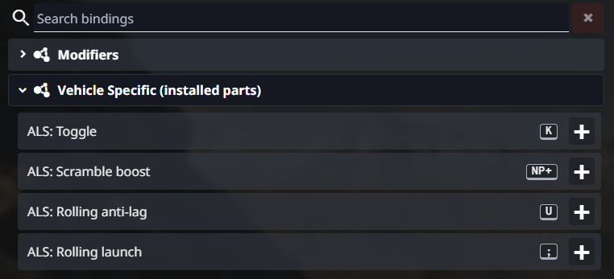
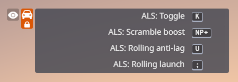
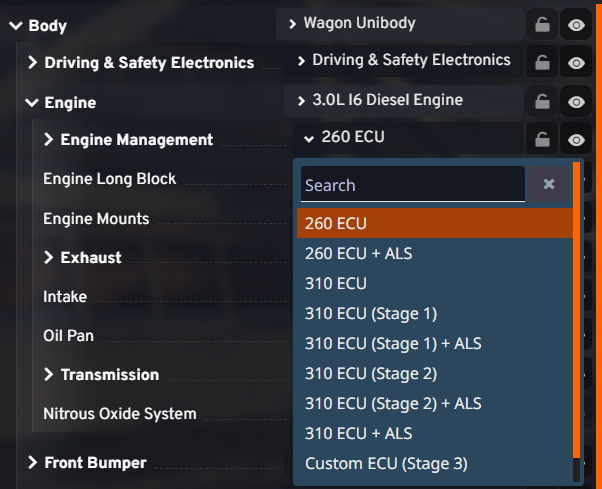
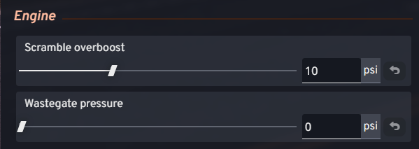

# ALS: Anti-Lag System

Anti-lag on every turbocharged car BeamNG ships.

[](https://www.beamng.com/resources/als-anti-lag-system.40159/) [](https://github.com/AyQWERTY/beamng-als/releases/tag/v2.0.0)

If you want the **cars from other mods** as well, there are two ways: the universal release linked above,
or a build of your own with `--mods` ([Running the build](#running-the-build)). The universal release
needs no build, but it replaces the game's own turbocharger code, which is why it is not on
beamng.com.

The mod adds one function: anti-lag. Everything else about the turbo stays as it was. Vanilla
anti-lag parts have their power written into jbeam; here it is calculated from that turbo's own
wastegate pressure and pressure curve, which lands on the same kind of numbers.

[](https://www.youtube.com/watch?v=5gnrHvG4MQY)

## Controls

| Key | Action | What it does |
|---|---|---|
| `K` | Toggle ALS | Default is on |
| `NumPad +` | Scramble | Toggle: raises the boost set point for an overboost until pressed again |
| `U` | Rolling anti-lag | Hold to keep anti-lag running while driving |
| `;` | Rolling launch | The rev cut jumps to the RPM the engine is at, and anti-lag is forced on |

The four actions sit under **Vehicle Specific (installed parts)** in Settings → Controls.



They also show up in the in-game bindings legend:



## Parts

The mod ships an ALS variant of the engine-management part of every turbocharged car. It is installed
like any other part, under **Engine Management** in the vehicle config:



## Tuning

Every ALS part adds two sliders under **Engine**:

- **Scramble overboost**: 0 to 30 psi added while the scramble key is active (default 10). If the
  turbo already sits at its physical ceiling and cannot spin faster, the extra pressure will not
  appear, or will be smaller than the slider says.
- **Wastegate pressure**: raises the pressure the wastegate holds, up to the top of that turbo's own
  curve. It only shows up where the stock part has no wastegate slider.



## Running the build

```sh
python build.py                              # auto-detects the game, writes the mod into build/
python build.py --install                    # builds straight into current/mods/unpacked/als
python build.py --mods                       # also cover the vehicles in current/mods/repo
python build.py "D:\Games\BeamNG.drive" --install   # point at the game explicitly
```

The game directory is optional. No dependencies beyond the standard library. `--mods` is what pulls
the vehicles from other mods into the build; the published mod is built without it.

The table it prints marks each vehicle:

- `[MOD]` - the vehicle exists only in a mod
- `[+mod]` - a stock vehicle a mod adds parts to
- no marker - stock files only

## License

beamNG Common Development and Distribution License (bCDDL), v1.1. See `LICENSE`.
